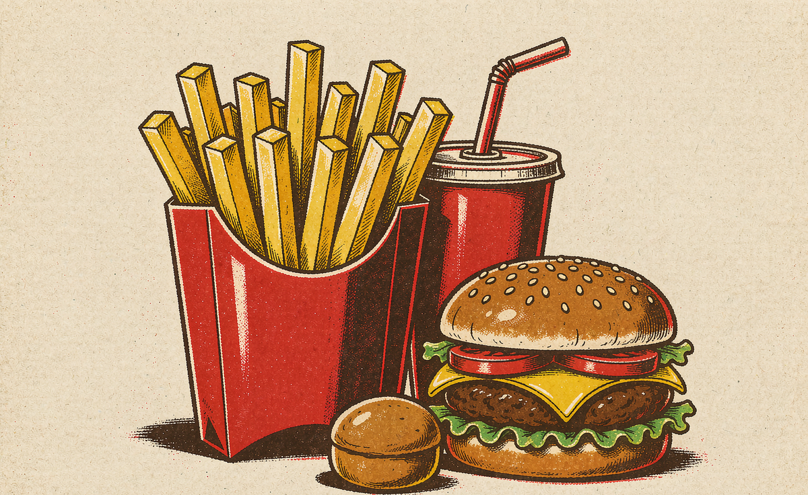
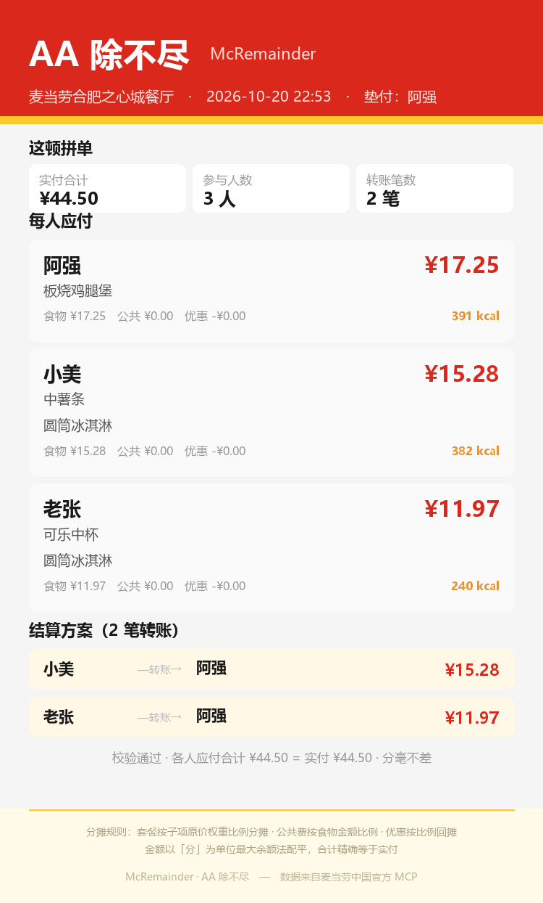

<div align="center">

# 🧮 AA 除不尽

**这顿 AA，除不尽。**

三个人拼一单 ¥44.50，除不尽；套餐里的堡和薯条价值不同，更除不清。<br>
McRemainder 基于麦当劳中国官方 MCP，把每一份食物拆到人头、算到分、转最少笔账。




*2026 麦当劳程序员创意开发大赛参赛作品*

</div>

---

## 📸 真实清算效果

> 以下卡片由**真实 MCP 数据**渲染：麦当劳合肥之心城餐厅实时菜单与官方核价，
> 非示意数据。你也可以用 `scripts/card_png.py` 一键生成自己的卡片。

<div align="center">

</div>

```
$ python scripts/cli.py --demo

门店：麦当劳合肥之心城餐厅          （真实 MCP 数据）
实付：¥44.50

  [套餐] 板烧鸡腿堡三件套 ×1  ¥34.50
        阿强   板烧鸡腿堡   权重 ¥23.50   ← query-meal-detail 拆解
        小美   中薯条       权重 ¥14.00
        老张   可乐中杯     权重 ¥ 9.50
  [单品] 圆筒冰淇淋 ×2  ¥10.00

  成员        食物      优惠       应付        热量
  阿强      ¥17.25   -¥0.00    ¥17.25     391 kcal
  小美      ¥15.28   -¥0.00    ¥15.28     382 kcal
  老张      ¥11.97   -¥0.00    ¥11.97     240 kcal

  校验：¥44.50 vs 实付 ¥44.50   ✓ 分毫不差

  结算方案（2 笔转账）：
    小美 → 阿强  ¥15.28
    老张 → 阿强  ¥11.97
```

**AA 平分是 ¥14.83 × 3 —— 喝可乐的老张为阿强的堡多付了 ¥2.86。**

## 🍔 为什么普通 AA 算不了麦当劳

麦当劳的计价单位大量是**套餐**，而拼单清算必须落到单品粒度。
这件事只有拿到 MCP 的真实套餐结构才可能算对：

| 拼单现场 | 普通 AA | McRemainder（调 MCP） |
|---|---|---|
| 三件套 ¥34.5，A 吃堡 B 吃薯条 C 喝可乐 | 只能平分 | `query-meal-detail` 拆出子项，按**原价权重**分摊：17.25 / 10.28 / 6.97 |
| 换配改价（大薯条 +¥2、玉米杯 −¥1） | 不知道 | `diffPrice` 是相对默认项差价，任意换配精确定价 |
| 整单优惠 ¥10 该谁享受 | 拍脑袋 | `calculate-price` 的 discount 按各人金额比例回摊 |
| 打包费 / 配送费 / 餐具费 | 忘了算 | 核价接口单独返回，按食物金额或人头分摊 |
| ¥100 三人分，差 1 分钱 | 四舍五入，账平不了 | 全程按「分」整数计算 + 最大余额法，**分毫不差** |
| 谁转给谁 | 全员互转 N×(N−1) 笔 | 债务最小化，**最多 N−1 笔** |
| 每人吃了多少热量 | 算不了 | 160 条官方营养数据按归属聚合 |

## 🚀 三种用法

### ① 网页 Demo（零 Token，路人即开即玩）

打开 [`demo/index.html`](demo/index.html)（本地双击即可，亦可部署 GitHub Pages）。
菜单、43 个套餐拆解、160 条营养数据全部预取自 MCP 快照，
纯前端运行，零网络请求、零登录、零 Token。

### ② CLI（真实 MCP 实时核价）

```bash
export MCD_MCP_TOKEN=你的Token     # https://open.mcd.cn/mcp 申请

python scripts/cli.py --demo                                    # 内置示例
python scripts/cli.py --spec examples/plan.json                 # 自己的拼单
python scripts/cli.py --spec examples/plan.json --card 卡片.html  # HTML 清算卡
python scripts/card_png.py examples/result.json --out 卡片.png    # PNG 直发群
```

### ③ WorkBuddy Skill

把本仓库放入 `~/.workbuddy/skills/mcd-remainder/`，配置 MCP 连接器后直接对话：

> “我们仨拼单，阿强吃堡、小美吃薯条、老张喝可乐，再加两个圆筒，帮我算账”

## 🧾 拼单方案格式（`examples/plan.json`）

```json
{
  "city": "合肥", "keyword": "之心城",
  "people": ["阿强", "小美", "老张"],
  "payer": "阿强",
  "items": [
    { "code": "9900005462", "qty": 1, "share": [
        {"person": "阿强", "part": "板烧鸡腿堡"},
        {"person": "小美", "part": "中薯条"},
        {"person": "老张", "part": "可乐"} ] },
    { "code": "515837", "qty": 2, "share": [
        {"person": "小美", "qty": 1},
        {"person": "老张", "qty": 1} ] }
  ]
}
```

## 🔌 MCP 集成

本项目调用 **9 个**麦当劳官方 MCP 工具（架构、实测记录与踩坑详见
[MCP_INTEGRATION.md](MCP_INTEGRATION.md)）：

| 工具 | 用途 |
|---|---|
| `query-nearby-stores` | 定位门店 |
| `query-meals` | 真实菜单与价格（子项估价基准） |
| `query-meal-detail` | **套餐拆解**（本项目核心依赖） |
| `calculate-price` | 真实核价：行实付 / 整单优惠 / 打包 / 配送 / 餐具费 |
| `list-nutrition-foods` | 每人热量账单（160 条） |
| `query-store-coupons` | 门店可用券 |
| `query-my-coupons` | 卡包已有券 |
| `available-coupons` | 可领券（拼单凑单提示） |
| `query-my-account` | 积分归属提示 |

**只读为主，不自动下单、不自动领券。** 价格未经实时核实时明确标注，绝不编造。

## ⚖️ 分摊规则

1. **行内比例分摊** —— 每行订单按各归属子项的**原价权重**比例分摊实付金额
2. **公共费分摊** —— 打包 / 配送 / 餐具费按食物金额比例（或人头）分摊
3. **优惠回摊** —— 整单优惠按各人食物金额比例抵扣，没人白占便宜
4. **尾差配平** —— 以「分」为单位整数计算，最大余额法（Hare quota）分配余数
5. **债务最小化** —— 净额贪心匹配，N 人最多 N−1 笔转账

无法精确匹配菜单价的子项会**明确标注“估价”**，不冒充精确价。

## ✅ 测试

```bash
python tests/test_allocate.py   # 34 项分摊/配平/清算单元测试（无需网络）
python tests/smoke.py           # MCP 链路 7 项冒烟
python tests/e2e.py             # 真实数据端到端
```

## 📁 项目结构

```
mcd-remainder/
├── scripts/
│   ├── mcd_client.py   零依赖 MCP 客户端（urllib，双格式响应归一化）
│   ├── menu.py         菜单索引 / 名称匹配 / 营养匹配
│   ├── expand.py       套餐原子化拆解（diffPrice 差价定价）
│   ├── allocate.py     分摊引擎 + 最大余额法 + 债务最小化
│   ├── plan.py         端到端编排（9 个 MCP 工具）
│   ├── card.py         单文件 HTML 清算卡
│   ├── card_png.py     PNG 清算卡（Pillow，直发群聊）
│   ├── snapshot.py     MCP 数据预取（供离线 Demo）
│   └── cli.py          命令行入口
├── demo/               零 Token 网页 Demo（纯静态）
├── data/snapshot.json  43 套餐 × 106 餐品 × 160 营养 预取快照
├── assets/             清算卡效果图
├── examples/           拼单方案与清算结果示例
└── tests/              34 项单元 + 冒烟 + 端到端
```

## 🎯 目标用户

- **学生宿舍 / 同事拼单** —— 一起点麦乐送，谁点了什么一清二楚
- **垫付的人** —— 不用心算，一张卡片甩群里收钱
- **选择困难 + 省钱党** —— 拼单凑优惠门槛，优惠公平回摊

## 📜 声明

本项目为麦当劳程序员创意开发大赛参赛作品，由参赛者独立开发，非麦当劳官方产品。
餐品、价格、供应状态以麦当劳官方渠道实时结果为准；分摊结果仅供朋友间结算参考。
参赛声明见 [CONTEST_DECLARATION.md](CONTEST_DECLARATION.md)。

<div align="center">

**AA 除不尽的，交给余数。**

</div>

## License

MIT
